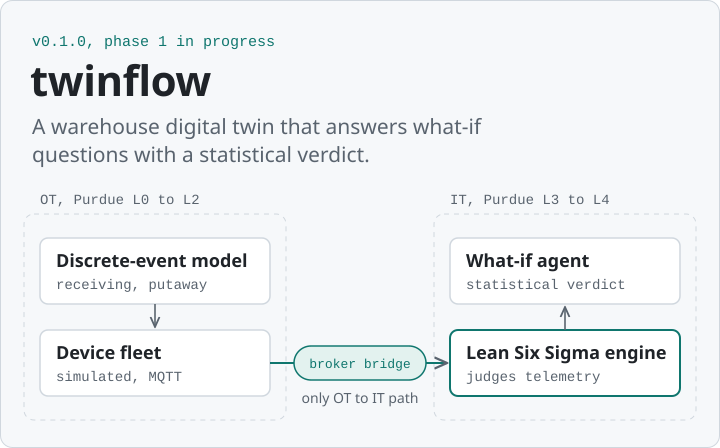
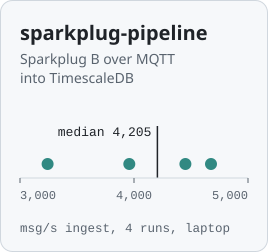
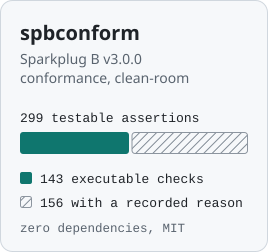
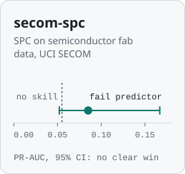

<picture>
  <source media="(prefers-color-scheme: dark)" srcset="assets/banner-dark.svg">
  
</picture>

I build connected devices and the systems behind them. On the device side, that means ESP32 firmware that keeps reporting over cellular from rooms nobody visits. Behind the device, I build the pipelines that carry industrial data and the models and statistics that show whether a process change worked.

**I'm available for contract work and full-time roles.** Email [johnragonhall@gmail.com](mailto:johnragonhall@gmail.com) with what you are building and when you need it.

[Portfolio and case studies](https://ragonxdragon.github.io) &nbsp;·&nbsp; [LinkedIn](https://www.linkedin.com/in/johnragonhall) &nbsp;·&nbsp; United States

## What I can help with

**Devices that drop offline in the field.** I write firmware that reports its own health and recovers without a site visit: on-device self-tests, a recovery ladder, OTA updates, and cellular backoff with jitter and a circuit breaker. Read the [recovery ladder](https://gist.github.com/ragonxdragon/40e022699158dc6cc4e20941b1def484) and [backoff](https://gist.github.com/ragonxdragon/dc041808503e7cbfaa6d99bd95b8b2a3) samples, or [how I worked out whether a field upload failure was a gateway stall or a firmware bug](https://ragonxdragon.github.io/case-studies/field-diagnostics.html).

**Telemetry nobody trusts.** Plant data shows up late, out of order, duplicated, or corrupt. [sparkplug-pipeline](https://github.com/ragonxdragon/sparkplug-pipeline) sends all of that on purpose, and an integration test checks where each message lands. [spbconform](https://github.com/ragonxdragon/spbconform) holds an edge node to the Sparkplug B specification.

**Models that fall apart on real process data.** I validate a model the way it will be used: a time-ordered split, class imbalance handled, PR-AUC with bootstrap confidence intervals, and a label-shuffle test. In [secom-spc](https://github.com/ragonxdragon/secom-spc), those checks showed a fail predictor that does not clearly beat chance, and the write-up says so. On a client camera project, five model versions trained on 6,761 images [raised order accuracy from a 72.0% hand-picking baseline to 94.1%](https://ragonxdragon.github.io/case-studies/vision-pick-audit.html).

**Process changes argued instead of tested.** I settle the argument with SPC, hypothesis tests, designed experiments, and Lean Six Sigma, and I check first whether a control chart can be trusted at all. [twinflow](https://github.com/ragonxdragon/twinflow) is the larger version of that idea: test a change on a simulated warehouse before anyone moves a shelf.

**Firmware fixes for a fleet with no rollback.** A bad update can cost a site visit, so I plan releases around that. Read [how I shipped fixes to a fleet with no rollback](https://ragonxdragon.github.io/case-studies/release-structure.html), and see the gates I run on every merge in [git-quality-gates](https://github.com/ragonxdragon/git-quality-gates).

## Selected work

<a href="https://github.com/ragonxdragon/twinflow"><picture>
  <source media="(prefers-color-scheme: dark)" srcset="assets/twinflow-dark.svg">
  
</picture></a>

**[twinflow](https://github.com/ragonxdragon/twinflow)** is a warehouse digital twin I am building in the open. In the design, a discrete-event model of receiving and putaway drives a simulated MQTT device fleet. A Lean Six Sigma engine judges the telemetry and the model's own predictions, and an AI agent answers what-if questions with a statistical verdict. The deployment follows the Purdue model, with the broker bridge as the only path between the OT and IT segments. Version 0.1.0 is out and phase 1 is in progress. [Read the docs](https://ragonxdragon.github.io/twinflow/).

<a href="https://github.com/ragonxdragon/sparkplug-pipeline"><picture>
  <source media="(prefers-color-scheme: dark)" srcset="assets/tile-sparkplug-pipeline-dark.svg">
  
</picture></a>
<a href="https://github.com/ragonxdragon/spbconform"><picture>
  <source media="(prefers-color-scheme: dark)" srcset="assets/tile-spbconform-dark.svg">
  
</picture></a>
<a href="https://github.com/ragonxdragon/secom-spc"><picture>
  <source media="(prefers-color-scheme: dark)" srcset="assets/tile-secom-spc-dark.svg">
  
</picture></a>

**[sparkplug-pipeline](https://github.com/ragonxdragon/sparkplug-pipeline)** carries Sparkplug B over MQTT into TimescaleDB and a dashboard, all from one `docker compose up`. Its simulator reorders, duplicates, and corrupts messages, wraps the sequence counter, and replays late data after an outage. Ingest ran at a median of 4,205 messages per second over four runs on a laptop.

**[spbconform](https://github.com/ragonxdragon/spbconform)** turns the Eclipse Sparkplug B v3.0.0 specification into a test suite. It carries all 299 testable assertions, runs executable checks for 143, and records the reason for each of the other 156. I wrote it clean-room with zero dependencies, under MIT.

**[secom-spc](https://github.com/ragonxdragon/secom-spc)** applies statistical process control to the UCI SECOM semiconductor data with I-MR charts, Nelson rules, EWMA, and CUSUM. An autocorrelation check decides whether a chart can be trusted; one sensor flags 81% of runs because its readings are autocorrelated. The fail predictor scores a PR-AUC of 0.085 against a 0.055 no-skill baseline, and the write-up reports that it does not clearly beat chance.

## Production work

Most of my production work is client firmware in private repositories, so I describe it here without names.

- **Cellular RFID gateway.** An ESP32 with an LTE modem reads an RFID reader over Ethernet and uploads through mbedTLS, managed with Azure IoT Hub device twins. It has OTA updates, on-device self-tests, a recovery ladder, native unit tests, libFuzzer harnesses, and GitHub Actions workflows for provisioning and deploys.
- **IoT Network Check.** A site network preflight and on-device connectivity self-test, built as a Windows and Linux CLI plus an ESP32 library in C++.

Case studies from client work, with names removed:

- [Gateway or device: placing an upload failure](https://ragonxdragon.github.io/case-studies/field-diagnostics.html)
- [Checking pick accuracy with a camera model](https://ragonxdragon.github.io/case-studies/vision-pick-audit.html)
- [Shipping firmware fixes to a fleet with no rollback](https://ragonxdragon.github.io/case-studies/release-structure.html)
- [A phone app and a TV display for an open-source radar sensor](https://ragonxdragon.github.io/case-studies/radar-companion.html)

## Engineering tools

- [performance-ladder-review](https://github.com/ragonxdragon/performance-ladder-review): a measure-first performance skill for AI coding agents, with a `PERF:` marker on every decision. One twinflow fix went from 73.91 ms to 0.291 ms at n=2,000, and a desktop app's startup bundle shrank from 813.2 KB to 672.0 KB.
- [git-quality-gates](https://github.com/ragonxdragon/git-quality-gates): git hooks and CI gates for conventional commits, a regression test on every fix, comment and prose standards, and a copyleft license allowlist. Every bypass gets logged.
- [claude-code-setup](https://github.com/ragonxdragon/claude-code-setup): a template Claude Code configuration with layered context, generated routing, guard hooks with a self-test, and validators.
- [engineering-templates](https://github.com/ragonxdragon/engineering-templates): document templates and a starter repo that run from discovery to production support, including PRD, ADR, FMEA, DOE, RCA, threat model, and release notes.
- [sim7600-emulator](https://github.com/ragonxdragon/sim7600-emulator): a SIM7600 AT-command emulator for bench-testing cellular firmware without a modem.
- [rfid-reader-emulator](https://github.com/ragonxdragon/rfid-reader-emulator): an HTTP/XML RFID reader emulator with seeded tags and fault injection.

Code samples: [recovery ladder](https://gist.github.com/ragonxdragon/40e022699158dc6cc4e20941b1def484) (C++17, boot-loop detection, no heap), [cellular backoff](https://gist.github.com/ragonxdragon/dc041808503e7cbfaa6d99bd95b8b2a3) (C++17, full jitter, circuit breaker), and a [Nelson rules checker](https://gist.github.com/ragonxdragon/897b5ff8f95737c4feb72646c48edca1) (Python, standard library only).

## How I work

I write the test first, and every bug fix ships with a regression test. A number in my docs comes from a recorded run; until I measure something, it says TBD. My deliverables use permissive licenses and clean-room code, with no copyleft. And because nobody watches the devices I ship, the firmware reports its own health and recovers on its own.

## Toolbox

| Area | Tools and evidence |
| --- | --- |
| Embedded | C, C++, ESP32, PlatformIO, FreeRTOS, mbedTLS, LTE modems |
| IoT and industrial data | Azure IoT Hub, MQTT, Sparkplug B, ISA-95, REST, time-series data in TimescaleDB ([sparkplug-pipeline](https://github.com/ragonxdragon/sparkplug-pipeline)) |
| Data science | Python and R; pandas, NumPy, SciPy, statsmodels, scikit-learn, Jupyter, matplotlib ([secom-spc](https://github.com/ragonxdragon/secom-spc)) |
| Machine learning | Supervised classification with time-ordered splits, class imbalance handling, PR-AUC, bootstrap confidence intervals, and label-shuffle tests ([secom-spc](https://github.com/ragonxdragon/secom-spc)); computer vision training and evaluation for object counting ([case study](https://ragonxdragon.github.io/case-studies/vision-pick-audit.html)) |
| LLM agents | Agent tooling and evaluation design, including grounding and abstention metrics ([twinflow](https://github.com/ragonxdragon/twinflow), [claude-code-setup](https://github.com/ragonxdragon/claude-code-setup), [performance-ladder-review](https://github.com/ragonxdragon/performance-ladder-review)) |
| Statistics and process | Statistical process control, hypothesis testing, DOE, Lean Six Sigma ([secom-spc](https://github.com/ragonxdragon/secom-spc), [twinflow](https://github.com/ragonxdragon/twinflow)) |
| Quality | Unit tests, libFuzzer, CI gates on GitHub Actions |
| Mobile and connected devices | React Native and TypeScript, Bluetooth LE GATT with HMAC-SHA256 challenge pairing, React kiosk UI, embedded Linux with systemd and HDMI-CEC, Flask APIs ([case study](https://ragonxdragon.github.io/case-studies/radar-companion.html)) |
| Other languages | TypeScript, PowerShell |
